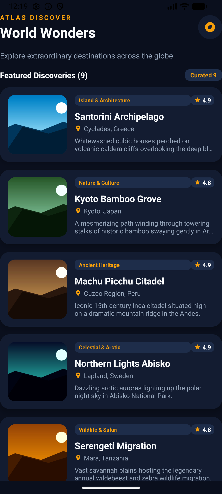
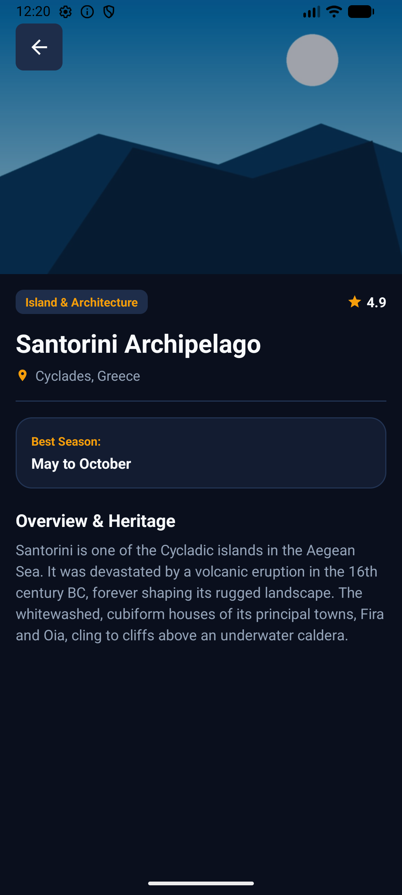

# Atlas Discover

**MCA Android Development - Experiment 7**  
**Project Repository:** `Android-Experiment-7-ListView-ImageView`

---

## 🎯 Aim

To create an adaptive Android application implementing a genuine Android `ListView` and `ImageView` with a custom `BaseAdapter`, ViewHolder pattern, custom row layout, and explicit Intent navigation between screens.

---

## 🛠️ Technologies & Architecture

- **Language:** Kotlin
- **UI Architecture:** XML layouts with a genuine Android `ListView`
- **Adapter:** Custom `BaseAdapter` with the ViewHolder pattern for efficient view recycling
- **Navigation:** Explicit `Intent` with `Serializable` data extras to open `DetailActivity`
- **Design System:** Material 3-inspired dark editorial theme with a deep navy background, warm cream typography, and gold accents
- **Adaptive UI:** Portrait, landscape, and large-screen layouts using Android resource qualifiers
- **System Integration:** Edge-to-edge window insets handling for status and navigation bars

---

## 🌟 Features

1. **Curated World Discoveries:** Displays nine extraordinary destinations, including Santorini, Kyoto Bamboo Grove, Machu Picchu, Northern Lights Abisko, Serengeti Migration, Taj Mahal, and Amalfi Coast.
2. **Local Drawable Thumbnails:** Uses local vector graphics stored in `res/drawable/` without remote URL dependencies.
3. **Optimized ListView Custom Row:** Each row contains a rounded card, category badge, rating indicator, location icon, title, and description.
4. **Detail Activity View:** Opens a modern detail screen with a hero image, destination overview, recommended travel season, and back navigation.
5. **Adaptive Screen Layouts:** Supports portrait, landscape, and tablet layouts, including split-screen details in landscape mode.

---

## 📸 Application Screenshots

The screenshots below demonstrate the main discovery list and the destination detail screen.

### 1. Discovery List Screen

This screen is the main entry point of the application. It presents a scrollable `ListView` of curated travel destinations. Each destination is displayed in a custom card-style row with its image, category, title, location, rating, and a short description. Users can select any row to view more information.

### 2. Destination Details Screen

This screen shows the detailed view for a selected destination. It uses a large hero image followed by the destination name, category, rating, overview text, and travel-season information. The screen is opened from the list using an explicit `Intent`, and users can return to the discovery list with the back action.

---

## 📁 Project File Structure

- `MainActivity.kt` - Main discovery listing activity
- `DiscoveryAdapter.kt` - Custom `BaseAdapter` with the ViewHolder pattern
- `DiscoveryItem.kt` - Serializable destination data model and curated items
- `DetailActivity.kt` - Detailed destination view with hero image
- `activity_main.xml` and `layout-land/activity_main.xml` - Adaptive main layouts
- `item_discovery.xml` - Custom `ListView` row card layout
- `activity_detail.xml` and `layout-land/activity_detail.xml` - Adaptive detail layouts
- `res/drawable/` - Vector graphics and icons
- `res/values/` - Colors, themes, strings, and responsive dimensions

---

## 🚀 Build & Run Instructions

1. Open the project in Android Studio Jellyfish or later.
2. Sync the project with the Gradle files.
3. Run the app on an Android Emulator or a physical device running API 24 or higher.
4. Tap any discovery row to open its detailed overview screen.
5. Rotate the device to test the adaptive landscape layout.
